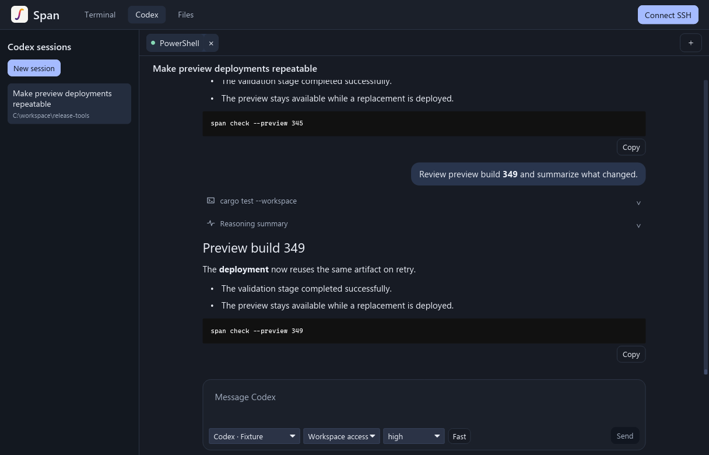

  
  <h1>Span</h1>
  
<strong>A desktop workspace for SSH terminals, remote files, and Codex sessions.</strong>

  

    <a href="https://github.com/vellinlab/span/releases/latest">Download</a> ·
    <a href="https://github.com/vellinlab/span/issues/new/choose">Report an issue</a> ·
    <a href="README.md">简体中文</a>
  

## What you can do

- Open multiple SSH terminals and browse, upload, or download files on remote hosts.
- Resume a local or remote Codex session and review commands, file changes, and approval requests in the conversation.
- Read Markdown, code, images, and diffs in a side panel while keeping the conversation open.

## Install the stable release

| Platform | File | Launch |
| --- | --- | --- |
| Windows x86_64 | `span-*-windows-x86_64.zip` | Extract the archive and open `Span/Span.exe`. |
| NewStartOS or EL8 x86_64 | `span-*-1.el8.x86_64.rpm` | Install the downloaded RPM with `sudo dnf install ./filename.rpm`, then run `span`. |

The local terminal is available on first launch. To use Codex, install and sign in to the Codex CLI on the machine where it will run. See the [Chinese user guide](docs/usage.md) for connection and configuration details.

## Electron preview

The [Electron workbench](https://github.com/vellinlab/span/tree/prototype/web-workbench/prototype) is developed on a separate branch. It explores a shared conversation interface for Codex, Claude Code, Pi, OpenCode, Kilo, and other agents. [Preview checks and artifacts](https://github.com/vellinlab/span/actions/workflows/web-workbench-preview.yml?query=branch%3Aprototype%2Fweb-workbench) are hosted on GitHub Actions.

## Contribute

When reporting a problem, include your platform, the release or preview commit, and steps to reproduce it. Open pull requests for the native app and repository documentation against `main`, and Electron workbench changes against `prototype/web-workbench`. Builds and installation tests run in GitHub Actions. See the [contribution guide](CONTRIBUTING.md) for details.
