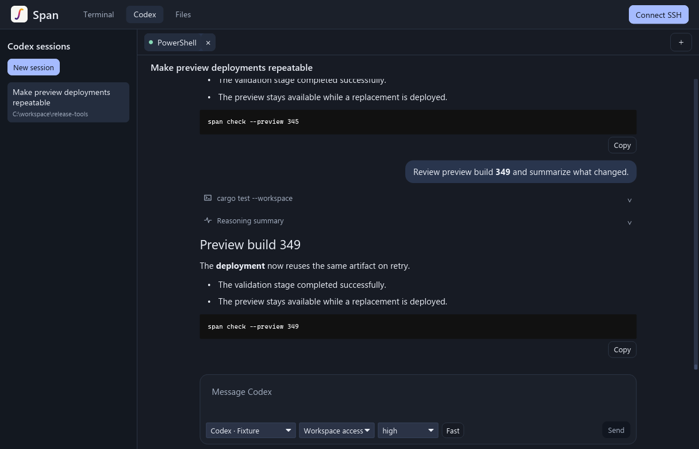
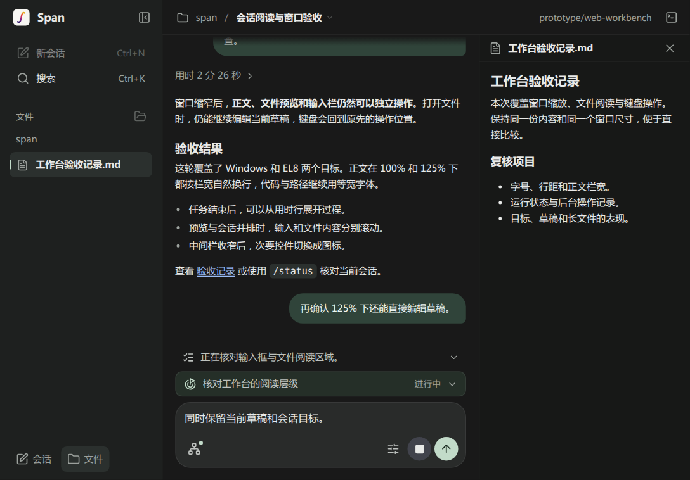

  
  <h1>Span</h1>
  
<strong>在一个桌面工作台里使用 SSH 终端、浏览远程文件、接续 Codex 会话。</strong>

  

    <a href="https://github.com/vellinlab/span/releases/latest">下载稳定版</a> ·
    <a href="docs/usage.md">使用指南</a> ·
    <a href="https://github.com/vellinlab/span/issues/new/choose">反馈问题</a> ·
    <a href="CONTRIBUTING.md">参与贡献</a> ·
    <a href="README.en.md">English</a>
  

## 用 Span 做什么

- **管理远程工作。** 从左栏切换 SSH 主机，在同一窗口打开多个终端，通过文件页访问、上传和下载文件。
- **接续 Codex 会话。** 在本机或 SSH 主机上打开已有会话，查看命令、文件变更和审批，继续当前任务。
- **就地阅读产物。** 在右侧查看 Markdown、代码、图片和差异，在回复或文件里选取内容带回对话。

## 下载与启动

前往 [GitHub Releases](https://github.com/vellinlab/span/releases/latest)，选择对应平台的文件。稳定版为原生桌面应用。

| 平台 | 下载文件 | 启动方式 |
| --- | --- | --- |
| Windows x86_64 | `span-*-windows-x86_64.zip` | 解压后运行 `Span/Span.exe` |
| NewStartOS／EL8 x86_64 | `span-*-1.el8.x86_64.rpm` | 用 `sudo dnf install ./文件名.rpm` 安装，运行 `span` |

打开应用即可进入本地终端。使用 Codex 时，在实际运行 Agent 的机器上安装并登录 Codex CLI。连接和配置步骤见[使用指南](docs/usage.md)。

## Electron 预览

[Electron 工作台](https://github.com/vellinlab/span/tree/prototype/web-workbench/prototype)在独立分支开发，探索把 Codex、Claude Code、Pi、OpenCode 和 Kilo 等后端接进同一套会话界面。可在 [预览验收](https://github.com/vellinlab/span/actions/workflows/web-workbench-preview.yml?query=branch%3Aprototype%2Fweb-workbench)查看 Windows 和 EL8 的检查与产物。

查看 Electron 预览界面

## 参与

欢迎提交[问题和需求](https://github.com/vellinlab/span/issues/new/choose)或阅读[贡献指南](CONTRIBUTING.md)。两条开发线均通过 [GitHub Actions](https://github.com/vellinlab/span/actions)运行构建和安装验证。
